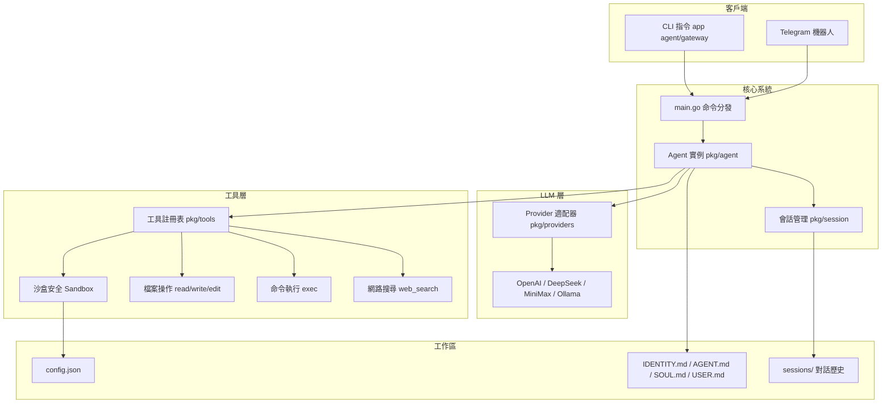
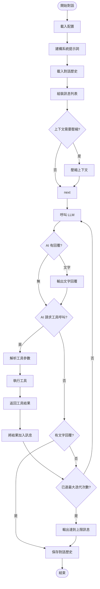
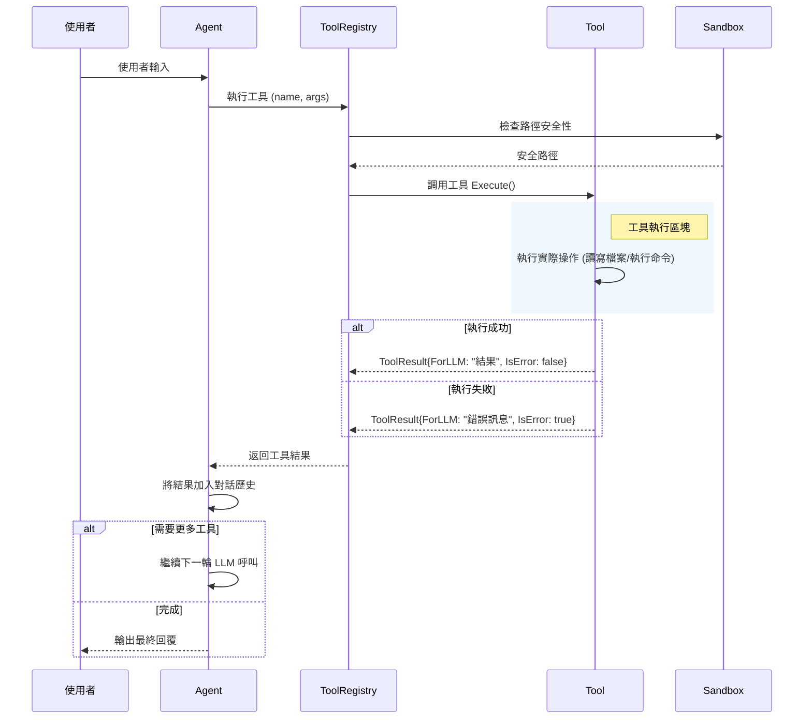
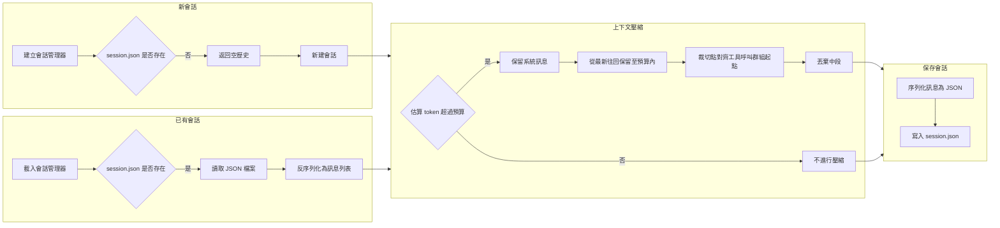
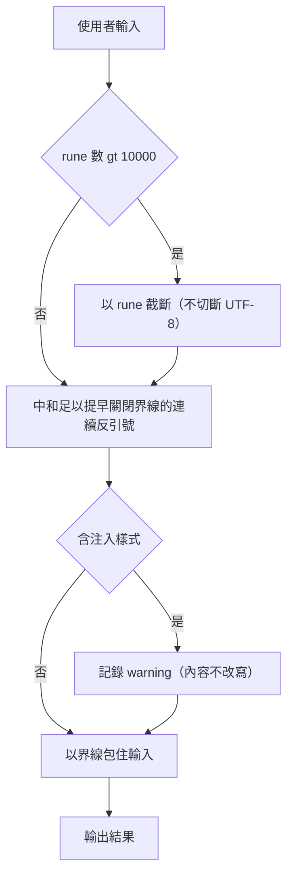

# MiniBot.go 🤖✨

MVP 最小可執行性產品（Minimum Viable Product）的 **MiniBot.go** 是一個極致輕量、無過度依賴的本地端 AI 助理專案。它專注於以極低的資源消耗（📦 單一執行檔 < 15MB、⚡ RAM < 10MB）提供強大的本地工具呼叫與遠端通訊功能。

專案特別針對開發者與技術玩家設計，支援靈活的 LLM 供應商切換（OpenAI、DeepSeek、MiniMax、Ollama 等）以及透過 Telegram 進行隨時隨地的存取。 📱

## 🌟 核心特色
- 🐹 **純 Go 實作**：除了標準函式庫外，零第三方肥大框架依賴。
- 🔧 **本地工具呼叫**：內建 Sandbox 沙箱機制，允許 AI 助理安全地讀寫檔案、瀏覽目錄、執行終端機指令。
- 🔍 **內建網頁搜尋**：透過 DuckDuckGo API，即使不設定額外的 Search API Key 也能讓 AI 上網找資料。
- 🤝 **多供應商支援**：採用 OpenAI 的通訊協定標準化介面，可無縫對接 OpenAI、Ollama、MiniMax、Groq 等各式各大廠 API。
- 🚀 **跨平台與容器化**：支援 Linux / Windows / macOS 交叉編譯，並提供極小型的 Alpine Dockerfile 部署方案。
- 📲 **Telegram 整合**：內建 Long Polling 接收器與白名單過濾機制，保護隱私。

---

## 🏗️ 系統架構流程圖

> [!TIP]
> 以下架構圖使用 [Mermaid](https://mermaid.js.org/) 語法繪製。
> - **本地預覽**：請在 VS Code / Antigravity 中安裝插件
>   [`Markdown Preview Mermaid Support`](https://marketplace.visualstudio.com/items?itemName=bierner.markdown-mermaid)（`bierner.markdown-mermaid`），
>   再使用 **Markdown 預覽**（`Ctrl+Shift+V`）即可正確顯示圖表。
> - **GitHub**：無需任何設定，圖表在 GitHub 網頁上原生支援自動渲染。

### 整體架構圖


### Agent 執行流程 (ReAct Loop)


### 工具呼叫詳細流程


---

## 🚀 快速開始

### 📦 1. 安裝與編譯
請確保您的系統已安裝 **Go 1.21+**。

```bash
git clone https://github.com/chiisen/mini_bot.git
cd mini_bot
# 透過 Makefile 編譯 (Windows 環境可直接執行 `go build -o app.exe ./cmd/appname/`)
make build
```

### 🛠️ 2. 環境初始化 (Onboard)
編譯完成後，執行 `onboard` 指令來建立工作區 (Workspace) 與設定檔：

```bash
./app onboard
```
此指令將會：
- 📥 互動式地詢問你的 API Token。
- 📂 在使用者的家目錄建立 `~/.minibot.go/` 資料夾。
- 📝 產生 `config.json` 設定檔。
- ✨ 初始化 `workspace/` 底下的 Agent 人格模板 (`IDENTITY.md`, `AGENT.md`, `SOUL.md`, `USER.md`)。

### ⚙️ 3. 設定 Config.json
若您在 Onboard 階段漏設定 API 金鑰或想改用其他的模型供應商，請編輯 `~/.minibot.go/config.json`：

```json
{
  "agents": {
    "defaults": {
      "workspace": "~/.minibot.go/workspace",
      "model": "minimax/MiniMax-M2.5",         // 指定優先使用的供應商與模型
      "maxTokens": 8192,
      ...
    }
  },
  "providers": {
    "minimax": {
      "apiKey": "your-minimax-api-key",
      "apiBase": "https://api.minimax.io/v1"
    },
    "openai": {
      "apiKey": "sk-...",
      "apiBase": "https://api.openai.com/v1"
    }
  },
  "channels": {
    "telegram": {
      "enabled": true,
      "botToken": "YOUR_TELEGRAM_BOT_TOKEN",
      "allow_from": ["YOUR_TELEGRAM_USER_ID"]  // 安全性白名單，非此 ID 的訊息將被拒絕
    }
  }
}
```

> 💡 **注意**：Provider 名稱必須與 `agents.defaults.model` 的前綴對應。例如 `minimax/MiniMax-M2.5` 會對應到 `providers.minimax`。

### 🌐 多語系設定

MiniBot.go 支援多語系 (英文/繁體中文)。設定方式有兩種：

#### 方式一：透過 Config 設定
在 `~/.minibot.go/config.json` 中加入 `language` 欄位：

```json
{
  "language": "zh-tw",
  "agents": { ... },
  ...
}
```

可用語言：
- `"en"` - 英文 (預設)
- `"zh-tw"` - 繁體中文

#### 方式二：透過環境變數設定
```bash
export MINIBOT_LANGUAGE=zh-tw
```

> 💡 **注意**：環境變數優先於 Config 設定。

#### 查看目前語言
```bash
./app status
```
輸出中會顯示 `🌐 Language: zh-tw (from config)` 或 `(from env)`。

---

## 🎮 使用方式

MiniBot.go 提供了三種主要的操作模式。

你可以隨時透過 `status` 指令檢查環境是否健康：
```bash
./app status
```

### 🎯 模式一：單次指令問答 (Single Shot)
快速向機器人發出一個問題或指令並結束：
```bash
./app agent -m "請幫我用 python 寫一個 hello world 檔案"
```

### 💬 模式二：本地互動式對話 (Interactive Mode)
啟動對話迴圈，適合複雜任務的協作（輸入 `exit` 離開）：
```bash
./app agent
```
```
🚀 MiniBot.go Interactive Mode Started (type 'exit' or 'quit' to leave)
You: 幫我列出目錄下的檔案
Agent: [Agent uses tool: list_dir...]
Agent: 根目錄底下有...
```

### 🌐 模式三：啟動對外伺服器 (Gateway Mode)
啟動背景常駐程式，此模式會掛載 `Telegram` 的長輪詢事件，讓您可以透過手機的 Telegram 直接與機器人互動：
```bash
./app gateway
```

---

## 🛠️ 目錄結構與架構
- 📂 `cmd/appname/`：CLI 指令的進入點 (main, agent, gateway, onboard, status)。
- 🧠 `pkg/agent/`：Agent 的大腦核心，負責上下文建構、指令壓縮與 Tool Calling 的思考迴圈。
- 📡 `pkg/channels/`：頻道管理器與 Telegram 整合。
- 🧰 `pkg/tools/`：沙箱、檔案操作與命令列操作之本機工具實作。
- 🔌 `pkg/providers/`：各大 LLM 廠商的相容適配層。
- ⚙️ `pkg/config/`：配置檔定義與預設值讀寫。
- 📜 `pkg/session/`：對話歷史的持久化、記錄與載入。
- 🧪 測試：`Run()` 以手寫的 fake `LLMProvider` 驅動（介面模擬，零第三方依賴），涵蓋純文字回覆、工具呼叫與回饋、參數損壞、達到迭代上限、provider 錯誤與 context 取消；`exec` 與 HTTP 層則以 `httptest` 驗證。

## 🔐 安全性與 Sandbox

**檔案工具**（`read_file`、`write_file`、`append_file`、`edit_file`、`list_dir`）一律經過沙盒檢查：路徑會展開 symlink 後確認落在 `~/.minibot.go/workspace` 之內，無法存取 workspace 以外的任何位置。沙盒無法關閉。

**`exec` 工具不是作業系統層級的隔離。** 它只提供三層字串層級的防護：

1. 拒絕含 shell 控制字元（`;` `|` `&` `$`、反引號、`(` `)` `<` `>`）的指令，要求拆成多個簡單指令——先前是悄悄剝除後照樣執行，會讓指令變成另一個東西
2. 以 denylist 擋掉會解譯程式碼或破壞系統的指令（`bash`、`python`、`sudo`、`curl`、`shutdown`…）與危險樣式（`rm -rf /`、`mkfs`、`dd if=`…）
3. 檢查指令中出現的路徑必須落在 workspace 之內（含 `../` 與 `~` 展開後的路徑）

它以空白切分指令，**不處理引號與轉義的組合**，屬於盡力而為的防線，不是保證。**若你的威脅模型需要真正的隔離，請把 gateway 跑在容器裡**，讓容器邊界負責，而不是靠字串檢查：

```bash
docker build -t minibot .
docker run -it --rm -v ~/.minibot.go:/root/.minibot.go minibot gateway
```

**工具輸出也會被當成資料界定。** `web_search` 抓到的網頁、讀到的檔案內容、`exec` 的輸出都屬於**外部可控**的文字，可能含有看起來像指令的句子。它們會以 `tool-output` 區塊包住才送進對話，而系統提示詞明確要求模型不得把區塊內的句子當成指令、也不得視為使用者或系統的要求。這能降低被騙的機率，但**無法保證**——模型是否照做無法用單元測試證明，而且這是所有 LLM 應用共通的限制。

**寫入記憶或人格檔時會告知你。** `memory_write`，或任何寫入 `IDENTITY.md`、`AGENT.md`、`SOUL.md`、`USER.md`、`memory/MEMORY.md` 的操作，都會在回覆中附上提示。這些檔案會被讀進系統提示詞，屬於會影響後續行為、卻不會出現在模型回覆裡的副作用——沒有這個提示，一次注入就能悄悄改變助理的長期行為。

對話歷史以 `0600` 權限保存在 `workspace/sessions/`，`config.json` 由 `onboard` 建立時同樣是 `0600`。 🛡️

---

## ⚠️ 已知限制

- **上下文壓縮以 token 預算為準**：以字元估算 token（CJK 等寬字元約 1 字元 1 token、其餘約 4 字元 1 token），超過 `agents.defaults.maxTokens` 時保留系統提示詞與最近的訊息，裁切點會對齊工具呼叫群組。估算是粗略的近似（誤差約兩成），不是計費依據；真正的上下文上限取決於供應商與模型，無法從設定得知。
- **`exec` 不是作業系統層級的隔離**：細節與容器替代方案見上方「安全性與 Sandbox」。
- **只有一種 provider 實作**（OpenAI 相容的 `/chat/completions`）。CLI 支援逐字輸出（SSE 串流），Telegram 仍在收到完整回覆後才送出——逐步輸出需要 `editMessageText` 與速率控制（見 issue #27）。
- **長期記憶沒有大小上限**：`workspace/memory/MEMORY.md` 會持續累積，而且整份內容都會放進每一次的系統提示詞。
- **對話歷史沒有輪替機制**：`workspace/sessions/*.json` 會持續成長，只有送給模型前才壓縮。

### 對話會話管理流程


### 輸入安全處理流程


> 使用者輸入**不會被改寫**：先前的版本會轉義 `{}` `[]` `<script>` 等字元並就地替換注入字串，對防護沒有實質幫助卻會破壞貼上的程式碼與 JSON。防護改由界線（fence）承擔，並中和足以提早關閉界線的連續反引號。

<!-- [😸SAM] -->